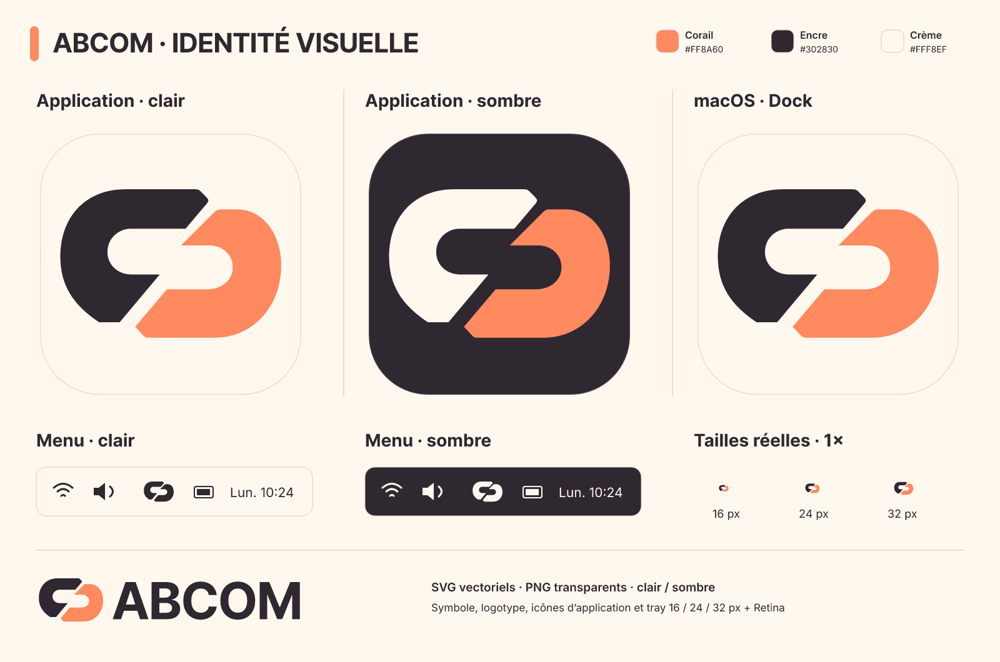

[English](README.md) · **Français**

# Identité visuelle Abcom

Reconstruction vectorielle de la référence fournie : deux maillons opposés, corail `#FF8A60`, encre `#302830`, crème `#FFF8EF`.



| Source SVG dans `svg/` | Usage |
|---|---|
| `abcom-symbol` / `abcom-symbol-on-dark` | Symbole bicolore sur fond clair / sombre |
| `abcom-symbol-ink` / `-cream` / `-coral` | Symbole monochrome |
| `abcom-symbol-outline` | Variante au trait |
| `abcom-wordmark` / `abcom-wordmark-on-dark` | Symbole et lettrage ABCOM converti en tracés |
| `abcom-app-light` / `abcom-app-dark` | Icônes d’application arrondies |
| `abcom-dock` | Icône d’application claire pour le Dock macOS |
| `abcom-tray-light` / `abcom-tray-dark` | Symbole de tray encre / crème |
| `abcom-tray-template` | Masque alpha noir pour une image modèle macOS |

Les PNG sont dans `png/`, sur fond transparent. Icônes d’application : 16 à 1024 px. Tray : 16, 24, 32, 48 et 64 px ; utiliser 32, 48 et 64 px pour les versions 2× de 16, 24 et 32 pixels logiques. Logotypes : 540, 1080 et 2160 px de large. Le lettrage SVG est converti en tracés et ne dépend d’aucune police installée.

Conserver les proportions et l’espace entre les maillons. L’application utilise l’icône couleur claire pour sa fenêtre et son lanceur. macOS utilise la variante Dock haute définition et un masque alpha pour la barre de menus, badge non lu compris ; AppKit l’adapte aux fonds clairs et sombres. Windows et Linux utilisent une icône de tray couleur avec une pastille corail pour les non-lus.

Les fichiers natifs sont `../app_icon.png` (512 px), `../app_icon.ico` (16 à 256 px) et `../app_icon.icns` (représentations standard/Retina). La dépendance de compilation `winresource` intègre l’ICO dans les exécutables Windows ; les raccourcis l’utilisent aussi. `scripts/package_macos.py` crée le bundle `.app` avec ICNS et métadonnées. Les installateurs Linux copient le PNG dans le thème hicolor de l’utilisateur.

## Chargement de l’icône réelle du Dock

Comme [Handy](https://github.com/cjpais/Handy/blob/main/src-tauri/tauri.conf.json), le bundle macOS fournit son ICNS. L’icône de fenêtre macOS passée à eframe est explicitement vide : dans eframe 0.37, `None` choisit le logo par défaut, tandis que `Some(IconData::default())` désactive le remplacement du Dock. Au retour du mode résident, AppKit restaure l’icône d’origine du bundle. `cargo run` utilise le même ICNS embarqué en repli.

Cette politique est centralisée dans `src/platform/icons.rs`. Le diagnostic suivant ouvre une courte fenêtre, attend trois frames puis mesure les pixels de l’icône réellement chargée par AppKit :

```sh
cargo run --locked --example check_macos_dock_after_frame
```

Le contrôle doit aussi passer après avoir empaqueté cet exécutable de diagnostic avec `scripts/package_macos.py`. L’option `--reproduce-old` sert de contre-épreuve : elle réactive le remplacement par le PNG de fenêtre et doit échouer. Les images de diagnostic sont écrites dans le dossier temporaire du système. [API AppKit de restauration](https://developer.apple.com/documentation/appkit/nsapplication/applicationiconimage).

## Tailles natives et conventions

- macOS, barre de menus : canevas logique de **18 × 18 points**, bitmap **36 × 36 px** à 2×, et `NSSquareStatusItemLength` pour laisser le système dimensionner la cible de clic. Cette taille est un choix de dessin d’Abcom ; les pixels Retina ne deviennent pas des points. Les marges du symbole sont conservées, y compris avec le badge. Le diagnostic AppKit vérifie les dimensions après chaque remplacement.
- macOS, Dock/Finder : les exports ICNS utilisent un corps de **824 × 824 px dans un canevas 1024 × 1024**, soit 100 px de marge de chaque côté. Ce gabarit a été comparé aux icônes Réglages et Terminal présentes sur le Mac de test : largeur visible identique de 206 px sur un canevas 256 px. Il concerne le pipeline ICNS du projet ; les couches Icon Composer ont leurs propres règles de masquage.
- Windows : ICO avec 15 représentations de 16 à 256 px, dont 20/24/40 px pour les facteurs DPI intermédiaires. Le tray consulte le DPI de la barre des tâches et `GetSystemMetricsForDpi(SM_CXSMICON)` ; il recharge ses bitmaps au prochain évènement UI si la métrique change. Les tailles usuelles 16/20/24/32/40/48/64 px sont testées avec le badge.
- Linux : le panneau StatusNotifierItem décide de la taille physique ; un bitmap 64 px est fourni. Le lanceur utilise hicolor. Les marges ICNS ne sont pas appliquées aux ressources Windows/Linux.

Sources primaires : [barre de menus Apple](https://developer.apple.com/design/human-interface-guidelines/the-menu-bar), [iconsets haute définition](https://developer.apple.com/library/archive/documentation/GraphicsAnimation/Conceptual/HighResolutionOSX/Optimizing/Optimizing.html), [tailles et DPI Windows](https://learn.microsoft.com/en-us/windows/apps/design/iconography/app-icon-construction), [StatusNotifierItem](https://www.freedesktop.org/wiki/Specifications/StatusNotifierItem/), [thèmes d’icônes freedesktop](https://specifications.freedesktop.org/icon-theme/latest/index.html).

Diagnostic sur un Mac avec une session graphique ouverte :

```sh
cargo run --locked --example check_macos_icon_sizes
```

Pour régénérer depuis la racine du dépôt, avec la dépendance SVG optionnelle existante :

```sh
python3 scripts/generate_branding.py
cargo run --locked --example export_branding --features avatar-svg
python3 scripts/build_native_icons.py
```

`exports.json` donne les noms et dimensions exacts ; `palette.json` contient la palette. Le moteur vérifie que les exports sont visibles, que le fond des icônes reste transparent et que le masque reste monochrome. Contrôler `preview.png` et les PNG du tray à leur taille réelle après toute modification des tracés.

La régénération ICNS utilise `iconutil` sous macOS ; les autres systèmes conservent le fichier ICNS versionné. Voir les recommandations Apple sur les [iconsets](https://developer.apple.com/library/archive/documentation/GraphicsAnimation/Conceptual/HighResolutionOSX/Optimizing/Optimizing.html) et les [images modèles](https://developer.apple.com/documentation/appkit/nsimage/istemplate).

Sous la [licence du dépôt](../../LICENSE). Le lettrage utilise la [police Inter embarquée](../fonts/Inter-OFL.txt).
