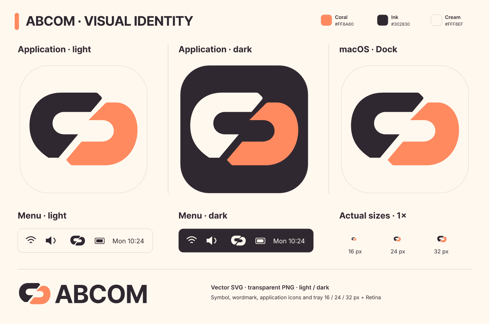

**English** · [Français](README.fr.md)

# Abcom visual assets

Vector reconstruction of the supplied reference: two opposing links, coral `#FF8A60`, ink `#302830`, cream `#FFF8EF`.



| SVG master in `svg/` | Use |
|---|---|
| `abcom-symbol` / `abcom-symbol-on-dark` | Two-colour symbol on light / dark backgrounds |
| `abcom-symbol-ink` / `-cream` / `-coral` | Single-colour symbol |
| `abcom-symbol-outline` | Outlined version |
| `abcom-wordmark` / `abcom-wordmark-on-dark` | Symbol and outlined ABCOM lettering |
| `abcom-app-light` / `abcom-app-dark` | Rounded application icons |
| `abcom-dock` | Light application icon for the macOS Dock |
| `abcom-tray-light` / `abcom-tray-dark` | Ink / cream tray symbol |
| `abcom-tray-template` | Black alpha mask for a macOS template image |

PNG exports are in `png/`, with transparent backgrounds. Application icons: 16–1024 px. Tray: 16, 24, 32, 48 and 64 px; use 32, 48 and 64 px for the 2× versions of 16, 24 and 32 logical pixels. Wordmarks: 540, 1080 and 2160 px wide. SVG lettering is converted into paths and requires no installed font.

Preserve the proportions and the space between the links. The application uses the light colour icon for its window and launcher. macOS uses the high-resolution Dock variant and an alpha template for its menu bar, including the unread badge; AppKit adapts it to light/dark backgrounds. Windows and Linux use colour tray icons with a coral unread badge.

Native files are `../app_icon.png` (512 px), `../app_icon.ico` (16–256 px) and `../app_icon.icns` (standard/Retina representations). The build-only `winresource` dependency embeds the ICO in Windows executables; shortcuts use it too. `scripts/package_macos.py` creates the `.app` bundle with ICNS and metadata. Linux installers copy the PNG into the user’s hicolor icon theme.

## Loading the actual Dock icon

Like [Handy](https://github.com/cjpais/Handy/blob/main/src-tauri/tauri.conf.json), the macOS bundle supplies its ICNS. The macOS window icon passed to eframe is explicitly empty: in eframe 0.37, `None` selects its default logo, while `Some(IconData::default())` disables Dock replacement. When leaving resident mode, AppKit restores the original bundle icon. `cargo run` uses the same embedded ICNS as a fallback.

This policy lives in `src/platform/icons.rs`. The following diagnostic opens a short-lived window, waits three frames, then measures the actual icon pixels loaded by AppKit:

```sh
cargo run --locked --example check_macos_dock_after_frame
```

It must also pass when this diagnostic executable is packaged with `scripts/package_macos.py`. `--reproduce-old` is the negative control: it re-enables replacement with the window PNG and must fail. Diagnostic images are written to the system temporary directory. [AppKit icon restoration API](https://developer.apple.com/documentation/appkit/nsapplication/applicationiconimage).

## Native sizing and conventions

- macOS menu bar: **18 × 18 logical points**, a **36 × 36 px** 2× bitmap, and `NSSquareStatusItemLength` to let the system size the click target. This is Abcom’s drawing size; Retina pixels do not become points. Symbol padding is preserved, including with the unread badge. The AppKit diagnostic checks dimensions after every replacement.
- macOS Dock/Finder: ICNS exports use an **824 × 824 px body in a 1024 × 1024 canvas**, leaving 100 px per side. This layout was compared with Settings and Terminal icons on the test Mac: each has a visible width of 206 px on a 256 px canvas. It applies to this project’s ICNS pipeline; Icon Composer layers have their own masking rules.
- Windows: 15 ICO representations from 16 to 256 px, including 20/24/40 px for intermediate DPI scales. The tray queries taskbar DPI and `GetSystemMetricsForDpi(SM_CXSMICON)`; it reloads its bitmaps at the next UI event when the metric changes. Common 16/20/24/32/40/48/64 px sizes are tested with the unread badge.
- Linux: the StatusNotifierItem panel controls physical display size; a 64 px bitmap is supplied. The launcher uses hicolor. ICNS margins are kept separate from Windows/Linux artwork.

Primary sources: [Apple menu bar](https://developer.apple.com/design/human-interface-guidelines/the-menu-bar), [high-resolution iconsets](https://developer.apple.com/library/archive/documentation/GraphicsAnimation/Conceptual/HighResolutionOSX/Optimizing/Optimizing.html), [Windows sizes and DPI](https://learn.microsoft.com/en-us/windows/apps/design/iconography/app-icon-construction), [StatusNotifierItem](https://www.freedesktop.org/wiki/Specifications/StatusNotifierItem/), [freedesktop icon themes](https://specifications.freedesktop.org/icon-theme/latest/index.html).

Run the diagnostic in a logged-in macOS graphical session:

```sh
cargo run --locked --example check_macos_icon_sizes
```

To regenerate from the repository root, using the existing optional SVG dependency:

```sh
python3 scripts/generate_branding.py
cargo run --locked --example export_branding --features avatar-svg
python3 scripts/build_native_icons.py
```

`exports.json` lists the exact filenames and dimensions; `palette.json` holds the palette. The renderer checks that exports are visible, that icon backgrounds remain transparent and that the template stays monochrome. Inspect `preview.png` and the native-size tray PNGs after changing the geometry.

ICNS regeneration uses macOS `iconutil`; other systems retain the committed ICNS. See [Apple’s iconset guidance](https://developer.apple.com/library/archive/documentation/GraphicsAnimation/Conceptual/HighResolutionOSX/Optimizing/Optimizing.html) and [template images](https://developer.apple.com/documentation/appkit/nsimage/istemplate).

Covered by the repository [license](../../LICENSE). Lettering uses the bundled [Inter font](../fonts/Inter-OFL.txt).
