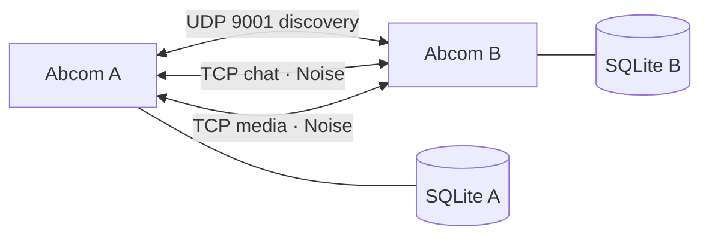

# 02 — Architecture

**English** · [Français](../02-architecture.md) · [Documentation](../README.md)

## Process and threads

Abcom is one executable with:

- the main eframe/egui event loop for rendering and interaction;
- a two-worker Tokio runtime for UDP discovery, TCP reception, persistent connections and media streaming;
- dedicated workers for SQLite, audio playback, media maintenance, initial emoji decoding and copying downloads;
- a bounded four-thread pool for preparing attachments and ZIP archives.

Tokio `mpsc` channels connect these components. `AppState` is shared through `Arc<Mutex<_>>`; rendering uses derived snapshots rather than rebuilding all state under its lock.

```text
GUI → NetworkSendRequest / MediaSendJob → Tokio networking
GUI → StorageCmd → SQLite writer → abcom.db (WAL)
Networking / storage → AppEvent → GUI wake-up → updated snapshots
```

The Linux tray uses KSNI over D-Bus. The library manages its workers; application code retains the icon and publishes badge changes directly, without polling a flag every 200 ms. macOS/Windows retain their native menu integration.

## Network topology




## Module map

| Module | Responsibility |
|---|---|
| [lib.rs](../../src/lib.rs) | Reusable application core and integration-test entry point |
| [main.rs](../../src/main.rs) | Configuration, channels, storage, identity, workers and GUI startup |
| [config.rs](../../src/config.rs) | Instance ports and data directories |
| [identity.rs](../../src/identity.rs) | Machine identity and key permissions |
| [discovery.rs](../../src/discovery.rs) | Signed announcements, peer presence and state-change events |
| [network](../../src/network/mod.rs) | Noise, connection pool, packet send/receive and media streaming |
| [message](../../src/message/mod.rs) | Wire types and application events |
| [app](../../src/app/mod.rs) | Conversations, groups, peers, receipts, transfers and storage |
| [ui](../../src/ui/mod.rs) | Panels, composer, settings, appearance, caches and media viewer |
| [services](../../src/services/mod.rs) | Klipy and Fontsource clients |
| [archive.rs](../../src/archive.rs) | ZIP preparation for folder transfers |
| [platform](../../src/platform/mod.rs) | Tray, startup and notification integration |
| [emoji_registry.rs](../../src/emoji_registry.rs) | Embedded PNG emoji registry |
| [unit tests](../../src/tests/test_ui_app.rs) | Tests live in `src/tests/`, one file per tested module |
| [P2P integration](../../tests/p2p_e2e.rs) | Authenticated exchange over a real socket |

## Incoming message flow

1. The TCP server decrypts a frame from an authenticated Noise session.
2. It parses the packet, checks it against the session identity and emits an `AppEvent`.
3. `UiSender` requests a repaint; `process_events` updates application state and queues a storage command.
4. The writer commits messages, then emits `MessagesPersisted`. Only then may delivery ACKs be sent.
5. Changed generation counters invalidate the relevant derived snapshots.

## Rendering and caches

The GUI wakes for input, network, tray or storage events. Hidden in the tray, it processes events without building the visible interface. Maintenance uses a slow fallback wake-up.

`AppState` tracks content and presence generations. [snapshot.rs](../../src/ui/snapshot.rs) builds:

- `ChatCache`: parsed Markdown, author/day grouping, resolved replies, receipts and reactions. It changes with content, conversation or date.
- `SidebarCache`: peers, aliases, groups and unread counts. It depends on content and presence.

The visible history is a window of roughly 100 messages. Scrolling upwards loads older pages of 100 from SQLite using keyset pagination and compensates the scroll offset. Initial storage loading is 500 messages; the memory window is bounded independently of the full database.

Image previews are reduced before texture creation, with a 32-entry LRU. Full resolution belongs to the viewer and is released on close. Off-screen GIF widgets are omitted while keeping their layout height. Image frames are released when the corresponding content leaves the loaded window or picker.

Appearance changes have their own revision, rebuilding styles, fonts and affected caches. Built-in themes remain immutable; editing a color creates a personal theme.

## Window lifecycle

```text
Close / Cmd-W → intercept → hide window → release textures
Tray → Open   → show and focus → invalidate rendering caches
Tray → Quit   → exit → flush storage
```

On macOS, hiding also removes the Dock icon. Without tray support, or when the Linux tray cannot be created, closing exits instead. Notifications and local storage continue working while the window is hidden.

## Performance evidence

The July 2026 macOS release measurements reported a reduction from 22% to about 0.2% idle CPU, 443 to about 155 MB RSS, and 15 to 8 threads. These are dated observations on one setup, not current cross-platform guarantees. The former automatic media-size limit was subsequently removed; retention is now manual. See [history and audits](08-history-and-audits.md) and [remaining measurements](09-limitations.md).
